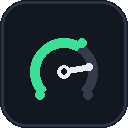
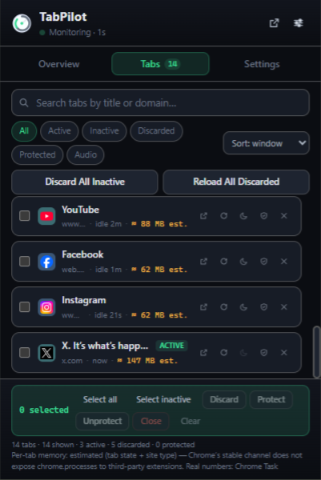
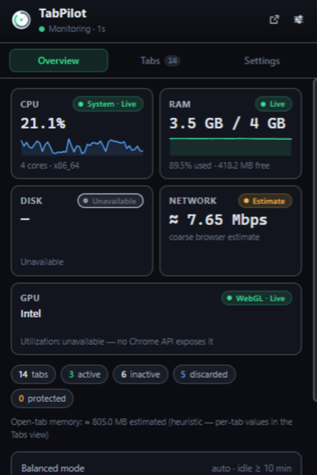
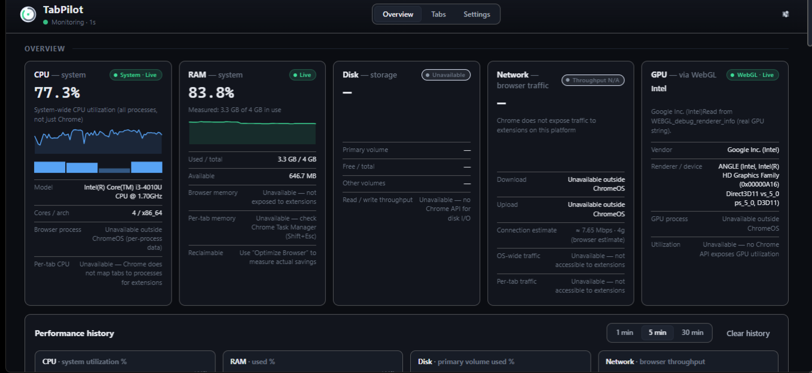
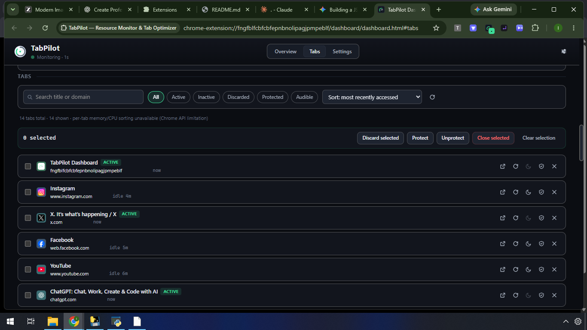
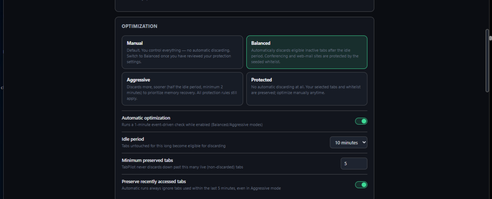

  
  <h1>TabPilot</h1>
  
<strong>See what your browser is using. Keep your tabs under control.</strong>

  
A simple way to monitor system resources, manage inactive tabs, and make your Chrome browsing feel smoother.

  

    
    
    
    
    
  

---

## ✨ A smoother browsing experience

Too many open tabs can make it difficult to know what is using your computer's resources. TabPilot brings useful system information and practical tab controls together, so you can see what's happening and clean up tabs you are not using—without closing them.

## 📸 Screenshots

  
   
  <strong>Quick Tab Controls</strong> — review open tabs and take action directly from the popup.

  
   
  <strong>Resource Overview</strong> — see key system metrics at a glance.

  
   
  <strong>Performance Dashboard</strong> — explore resource metrics and performance history in one place.

  
   
  <strong>Tab Manager</strong> — search, filter, and manage your open tabs.

  
   
  <strong>Personalize TabPilot</strong> — configure monitoring, optimization, protection, and appearance.

## 🚀 Features

### Understand your system

- View CPU and memory usage at a glance.
- Check storage capacity and available disk space.
- See available network activity and graphics-device information.
- Open the dashboard for detailed metrics and performance history.

### Take control of your tabs

- Search, filter, sort, and review open tabs.
- Focus, reload, discard, protect, or close individual tabs.
- Select multiple tabs for bulk actions.
- Discard inactive tabs without closing them; Chrome can reload them when you return.

### Optimize when it suits you

- Run **Optimize Browser** whenever you choose.
- Keep automatic tab cleanup off by default, or enable Balanced or Aggressive optimization.
- Protect important sites so their tabs are skipped during optimization.
- Adjust idle-time and tab-preservation preferences.

### Make it yours

- View performance history for supported metrics.
- Choose a light, dark, or system theme.
- Customize monitoring and optimization settings.
- Keep your data on your device—TabPilot does not require an account or cloud service.

## ⚡ Install in Chrome

The provided ZIP contains the ready-to-load extension. You do not need Node.js, npm, or a build step.

1. **Download** the TabPilot ZIP and extract it to a folder on your computer.
2. Open **[chrome://extensions](chrome://extensions)** in Google Chrome.
3. Turn on **Developer mode**.
4. Click **Load unpacked**.
5. Select the extracted **`tabpilot`** folder—the folder that directly contains `manifest.json`.
6. Pin TabPilot from Chrome's Extensions menu for quick access.

> **Note:** Chrome's **Load unpacked** option loads an extracted folder, not a `.zip` file. Do not select the ZIP itself; extract it first and select the folder containing `manifest.json`.

## 🔒 Your privacy

TabPilot is designed to work locally in your browser. It does not require an account, cloud sync, or tracking service. Your settings and extension data are stored in your Chrome profile.

## 📄 License

TabPilot is available under the [MIT License](LICENSE).
